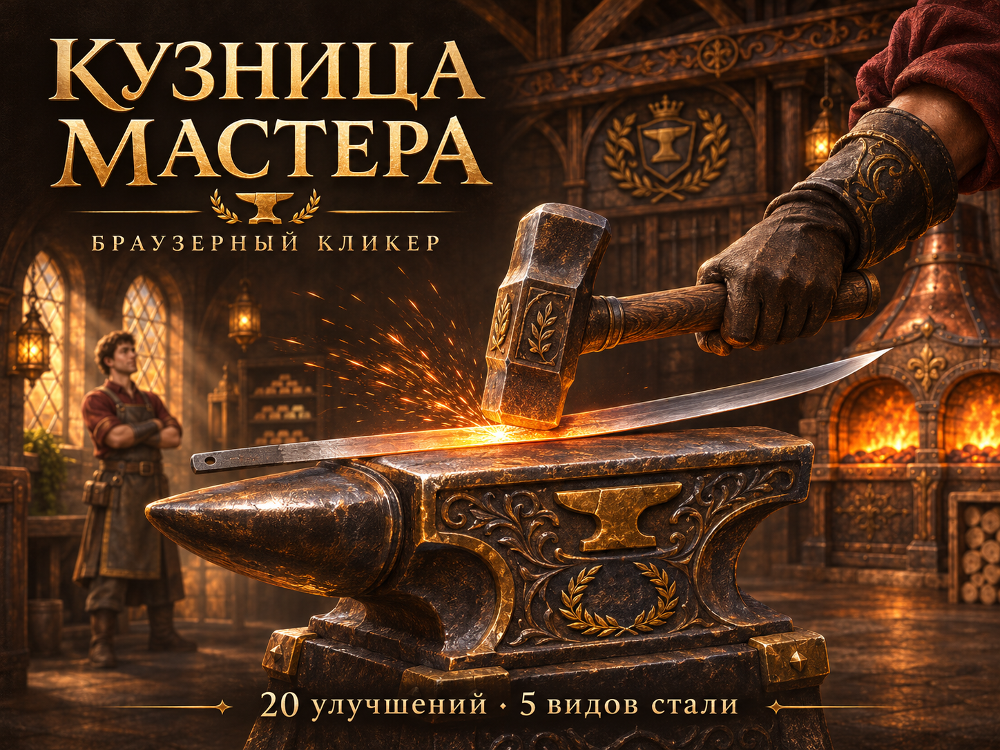
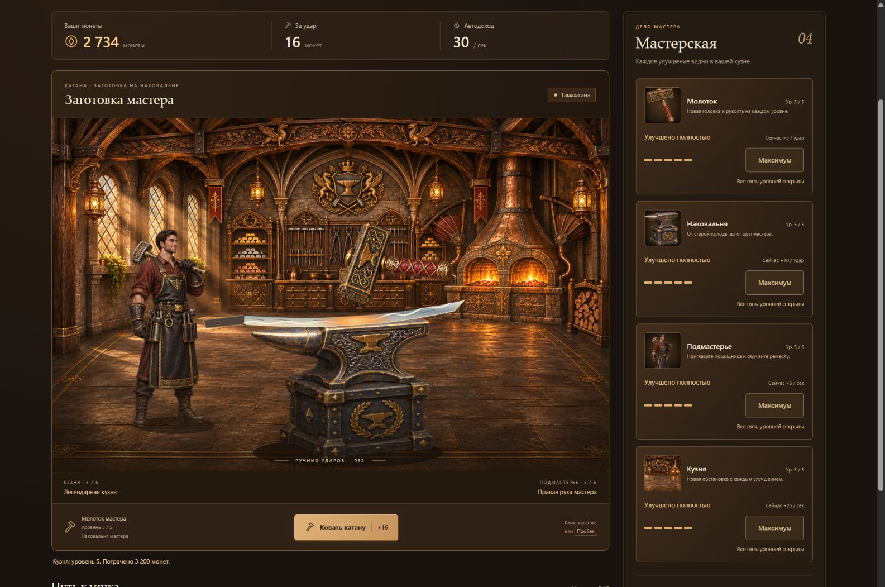
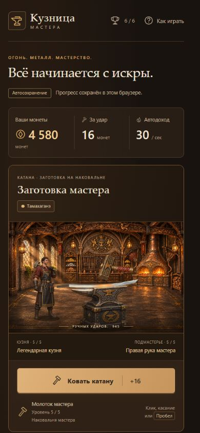

# Кузница мастера

Браузерный кликер о ковке катаны: наносите удары по заготовке, зарабатывайте монеты и развивайте одну средневековую мастерскую. Проект создан для портфолио и демонстрирует игровую экономику, визуальную прогрессию и адаптивный интерфейс на чистом JavaScript.



[Посмотреть игровой процесс — MP4, около 30 секунд](docs/media/gameplay.mp4)

## Возможности

- Четыре ветки улучшений по пять уровней: молоток, наковальня, подмастерье и кузня — всего 20 покупок.
- Каждая покупка меняет соответствующий элемент сцены. Подмастерье появляется после найма, кузня получает новый фон на каждом уровне.
- Пять ступеней стали, шесть достижений, анимация удара, искры и всплывающий доход.
- Ручной и автоматический доход, сохранение прогресса в браузере, сброс с подтверждением.
- Управление мышью, касанием и клавиатурой; поддержка уменьшения движения.
- Адаптивная компоновка для компьютера, планшета и телефона.

## Скриншоты

Настоящий интерфейс игры с максимальными улучшениями:

| Компьютер | Телефон |
| --- | --- |
|  |  |

## Локальный запуск

Игра не требует сборки, npm-пакетов, ключей API или серверной базы данных. Для запуска нужен современный браузер и Python 3, используемый только как локальный статический сервер.

1. Скачайте проект или клонируйте репозиторий:

   ```sh
   git clone https://github.com/shinelight-333/Browser-based-clicker.git
   cd Browser-based-clicker
   ```

2. Из каталога, содержащего `index.html`, запустите:

   ```sh
   python -m http.server 4186 --bind 127.0.0.1
   ```

   В macOS/Linux команда Python может называться `python3`.

3. Откройте [http://127.0.0.1:4186/](http://127.0.0.1:4186/). Для остановки сервера нажмите `Ctrl+C` в терминале.

Если порт занят, используйте другой, например `4188`, и откройте адрес с этим портом. Прогресс привязан к браузеру и адресу, включая порт: на другом адресе он будет отдельным. Локальная ссылка доступна только на компьютере, где запущен сервер; публичная версия проекта пока не опубликована.

Вместо Python можно использовать любой статический HTTP-сервер с корнем в папке проекта. Запуск через HTTP предпочтителен прямому открытию файла: так браузер предсказуемо загружает графику и хранит прогресс.

## Как играть

Нажимайте на сцену или кнопку «Ковать катану». Когда игровая кнопка в фокусе, `Enter` и `Пробел` наносят удар. Удержание клавиши не создаёт непрерывных ударов.

Молоток и наковальня повышают доход за удар. Подмастерье и кузня приносят монеты автоматически, пока текущая игровая сессия открыта, в том числе в неактивной вкладке. После закрытия игры доход не начисляется.

Материал заготовки открывается по общему заработку. Потраченные монеты продолжают учитываться:

| Ступень | Общий заработок |
| --- | ---: |
| Мягкая сталь | С начала игры |
| Углеродистая сталь | 500 монет |
| Закалённая сталь | 1 500 монет |
| Узорчатая сталь | 5 000 монет |
| Тамахаганэ | 10 000 монет |

Материалы — художественные игровые ступени; они меняют внешний вид и не дают множителей дохода. Полные формулы, цены и условия достижений описаны в [игровых правилах](docs/GAME_RULES.md).

## Сохранение

Прогресс сохраняется в `localStorage` под ключом `forge-master.save`: каждые пять секунд, при покупках и важных событиях, а также при уходе со страницы. При аварийном закрытии восстанавливается последнее успешное сохранение.

Очистка данных сайта удаляет прогресс. Синхронизации между браузерами и устройствами нет. При недоступном хранилище игра сообщает об этом и продолжает работать в памяти. Сброс выполняется кнопкой «Начать заново» с подтверждением.

Сохранения предыдущей версии совместимы: прежние уровни горна становятся уровнями кузни. Внутренний ключ `forge` сохранён.

## Стек и структура

HTML5, CSS3, JavaScript без фреймворков; SVG-композиция с растровыми фонами и спрайтами; Web Animations API; `localStorage`. Шрифты системные, внешние сервисы во время игры не используются.

```text
index.html                 Интерфейс, SVG-сцена и диалоги
styles.css                 Оформление и адаптивная компоновка
scripts/economy.js          Экономика, улучшения, материалы, достижения
scripts/storage.js          Проверка и сохранение прогресса
scripts/game.js             Связь модели и интерфейса
scripts/effects.js          Анимации и эффекты ударов
scripts/interface.js        Диалоги и управление фокусом
assets/art/                Фоны, спрайты и промпты генерации
tests/                     Автоматические проверки
docs/GAME_RULES.md          Правила и баланс
docs/QA_REPORT.md           Результаты и границы проведённых проверок
docs/media/                Обложка, скриншоты и видео для README
```

Игровая графика и обложка созданы с помощью встроенного ImageGen. Заготовка катаны и эффекты сцены описаны в SVG/CSS. Промпты игровых изображений доступны в [manifest.json](assets/art/manifest.json), а промпт обложки — в [cover-prompt.txt](docs/media/cover-prompt.txt).

## Проверки

Для автоматических тестов используется Node.js 24 с встроенным `node:test`. Дополнительные зависимости не нужны.

```sh
node --test tests/*.test.cjs
```

В проекте 23 теста: экономика, дробный доход, все покупки, пять материалов, достижения, восстановление и защита сохранений, совместимость прежнего формата. Подробности браузерной проверки, включая размеры 1440, 768, 390 и 320 пикселей, приведены в [отчёте QA](docs/QA_REPORT.md). Запуск проверок при работе над проектом согласуется с пользователем согласно [AGENTS.md](AGENTS.md).

## Материалы для портфолио

Полный комплект сохранён в `C:\tools\GPT\Portfolio\Clicker`. Копии обложки, двух снимков и ролика включены в `docs/media`, чтобы README оставался наглядным после клонирования репозитория.

| Файл | Назначение |
| --- | --- |
| `01-cover.png` | Иллюстрированная обложка |
| `02-desktop.jpg` | Полная страница компьютерной версии |
| `02-desktop-scene.jpg` | Компьютерная сцена и магазин, 1585 × 1051 |
| `03-mobile.jpg` | Полная страница мобильной версии |
| `03-mobile-screen.jpg` | Мобильный экран, 390 × 843 |
| `04-gameplay.mp4` | Реальный игровой процесс, Full HD, около 30 секунд |
| `cover-prompt.txt` | Промпт обложки для встроенного ImageGen |
| `video-info.json` | Сведения о захвате и монтаже ролика |
| `media-info.txt` | Состав комплекта и параметры файлов |

Скриншоты показывают настоящую игру, обложка — рекламную иллюстрацию. Ролик собран из последовательных кадров браузера во время игры; паузы накопления монет между фрагментами вырезаны. Формат — H.264 MP4, 1920 × 1080, 30 кадров/с на выходе; частота исходного захвата ниже. Музыка и звуковые эффекты не добавлены, поскольку в игре звука нет. Материалы не публикуются автоматически.
